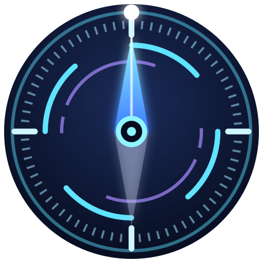
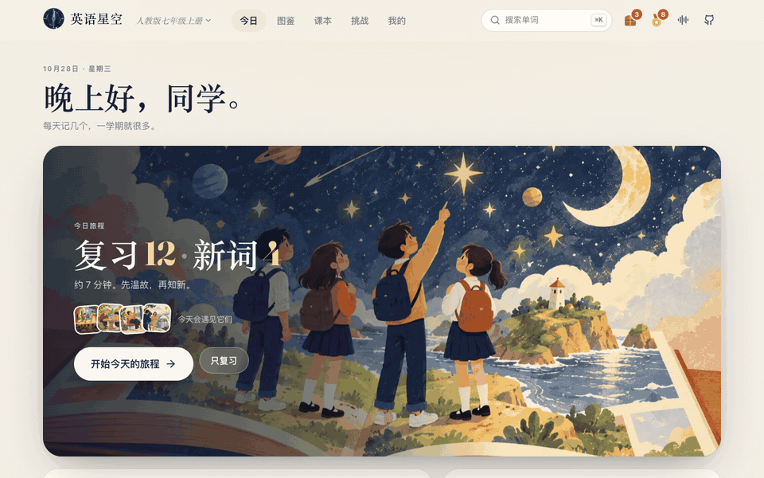
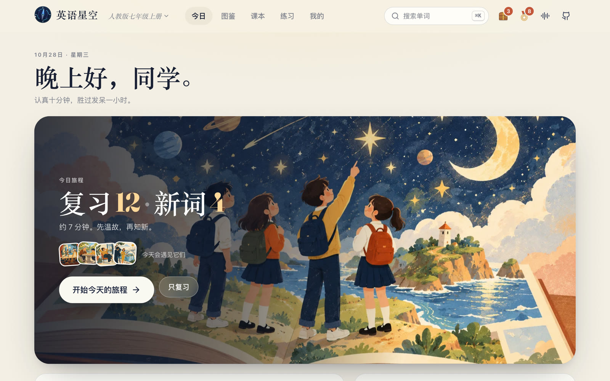
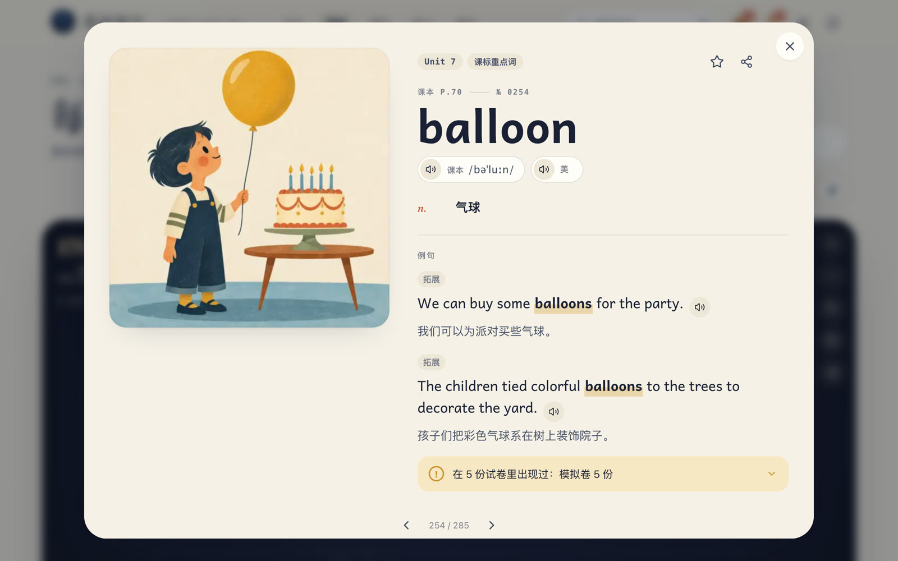
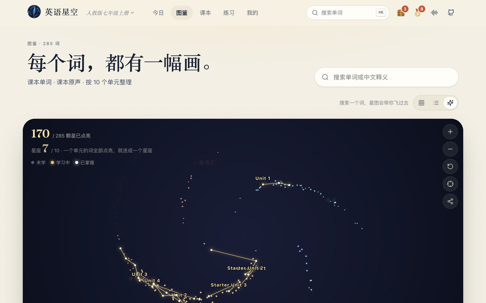
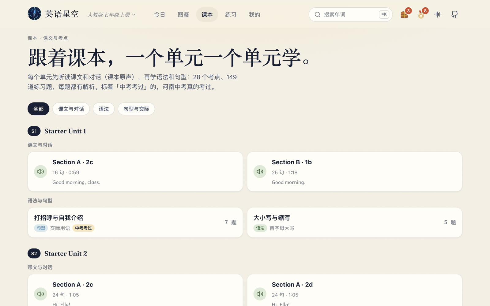
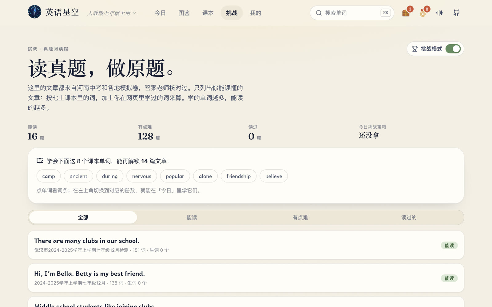
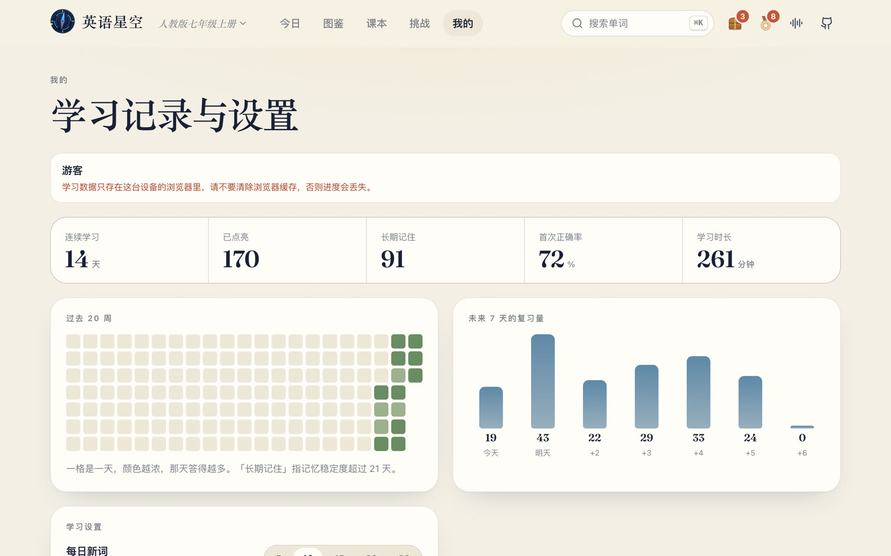
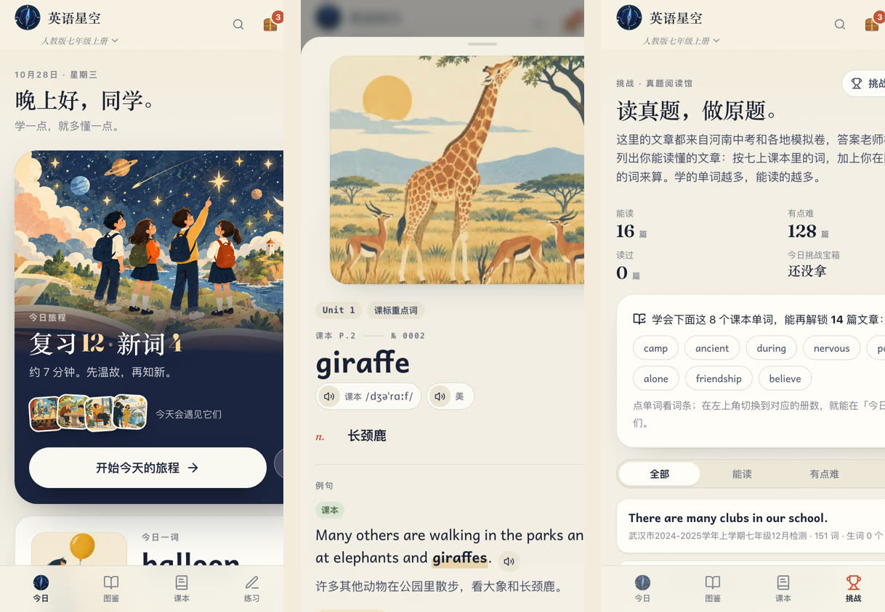
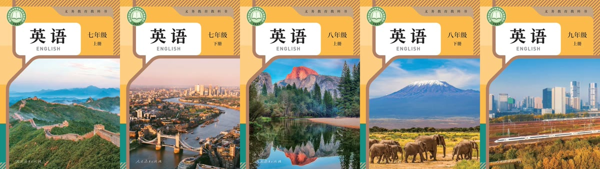

<div align="center">



# 英语星空 · English Galaxy

**课本的词，一个一个点亮。**

一个给初中生用的英语学习网页：人教版初中英语五册（七上、七下、八上、八下、九年级），<br>
每个单词一幅插画、课本原声、两句例句；课文点读、语法考点、河南中考真题，<br>
再加上一点让人每天想回来的小游戏。

[在线体验 gjenglish.com](https://gjenglish.com) · [功能](#功能) · [快速开始](#快速开始) · [导入自己的课本](#导入自己的课本) · [授权与版权](#授权与版权)


</div>

---

## 这是什么

英语星空是一位河南的一线初中英语老师，为自己班上的学生做的练习网页，现在开源出来，给更多老师和同学用。

- **跟着课本走**：词表、页码、课文都按人教版教材的单元排列，学的就是考的。
- **每个词都有画**：2,284 个课本词条，每个都配了插画；看见画面，比背中文意思记得牢。
- **按遗忘规律复习**：用 [FSRS](https://github.com/open-spaced-repetition/ts-fsrs) 算法（新版 Anki 用的开源算法）给每个人安排复习时间，快忘的时候才出现。
- **对准中考**：每个单词、每个考点都标出在河南中考和模拟卷里考过几次，点开能看原题。
- **手机就能用**：不用装 App，微信里打开网址就行；登录后进度存在云端，换手机接着学。

<div align="center">

</div>

## 数字

| 册 | 单词 | 例句 | 课文点读 | 语法与句型考点 | 练习题 |
|---|---:|---:|---:|---:|---:|
| 七年级上册 | 285 | 570 | 43 段 · 989 句 | 28 | 149 |
| 七年级下册 | 453 | 906 | 42 段 · 977 句 | 20 | 118 |
| 八年级上册 | 538 | 1,076 | 41 段 · 997 句 | 24 | 151 |
| 八年级下册 | 554 | 1,108 | 48 段 · 1,272 句 | 18 | 109 |
| 九年级 | 454 | 908 | 50 段 · 1,128 句 | 18 | 112 |
| **合计** | **2,284** | **4,568** | **224 段 · 5,363 句** | **108** | **639** |

另有：184 份真题和模拟卷的「考过」提示、真题阅读馆 276 篇文章、100 枚成就徽章、999 张冷知识卡。

## 功能

### 今日：每天十分钟

打开就知道今天要做什么：几个要复习的、几个新词，大约几分钟。新词五个一组：先「初见」（看图、听原声、读例句），再用选义、看图选词、听音选词、拼写来回忆。答错的词换个题型再出一次。



### 图鉴：每个词，都有一幅画

按单元、按类型（课标重点词、一般词汇、短语、地名与专名）浏览全部单词，学到哪一步一眼就能看到。


### 单词卡

插画 + 音标 + 课本原声 + 美音 + 两句例句：一句**课本原句**，一句**中考或模拟卷里的原句**（找不到时用改编句或自己写的，都标出来）。底部的黄色提示条告诉你这个词在多少份卷子里出现过。



### 星图

每个词是一颗星，学会一个点亮一颗；一个单元全部点亮，就连成一个星座。



### 课本：课文点读和考点练习

每个单元先听课文和对话（课本原声，点一句读一句，可以显示中文），再做语法和句型考点：讲解 + 例句 + 单选、填空、连词成句，每题都有解析和朗读，错题可以一键重练。考点名称和老师批改试卷用的「知识点」统一，方便对照学生的薄弱点。



### 挑战：真题阅读馆

给学有余力的同学：读河南中考和各地模拟卷的阅读原文、做原题。网页会根据你学过的词，算出哪些文章你「能读」、哪些「有点难」，学的词越多，解锁的文章越多。答错的题才显示解析，原文依据会标黄。



### 让人每天想回来

- **宝箱**：每日任务完成开今日宝箱，单元过关开单元宝箱，连续 7 天开周宝箱；里面有插画皮肤碎片、冷知识卡、补签卡、环境音乐、星图特效，还有老师奖励券。
- **成就徽章**：100 枚，分学习、挑战、练习、收藏、隐藏五类。
- **学习记录**：连续天数、学习热力图、未来 7 天的复习量。



### 手机上



### 五册随时切换

左上角点册名就能换，各册共用一份进度：在七下学过的词，到九年级照样按时复习。



### 老师页

老师可以看全班每个同学学了多少、哪些词和考点最容易错，以及挑战模式的成绩（需要配置云端，见下文）。

## 快速开始

需要 [Node.js](https://nodejs.org/) 20 或更新版本。

```bash
git clone https://github.com/wenchester8-droid/english-starry-sky.git
cd english-starry-sky
npm install
npm run dev
```

浏览器打开终端里显示的地址（默认 http://localhost:5173）。不做任何配置时，网页以**游客模式**运行：所有功能都能用，学习进度保存在这台设备的浏览器里。

打包成静态网页：

```bash
npm run build   # 输出到 dist/，可以放到任何静态网站托管上
```

### 开启登录和云端同步（可选）

登录、云端同步、老师页用的是[腾讯云开发](https://tcb.cloud.tencent.com/)（PostgreSQL 型环境）：

1. 新建一个云开发环境，复制 `.env.example` 为 `.env.local`，填上环境号 `VITE_CLOUD_ENV=...`。
2. 复制 `cloudbaserc.example.json` 为 `cloudbaserc.json`，填上环境号、服务端 API Key（`CLOUDBASE_APIKEY`）和老师页密码（`TEACHER_PASS`）。**这个文件不要提交到仓库。**
3. 部署云函数：`tcb fn deploy api`。云函数代码在 `cloud/functions/api/`，本地测试 `node --test cloud/register.test.cjs`。

## 导入自己的课本

`pipeline/`（Python）和 `scripts/` 里是把课本变成网页内容的全部工具，大致流程：

| 步骤 | 工具 | 做什么 |
|---|---|---|
| 词表 | `pipeline/parse_vocab.py`、`build_book.py` | 从课本 PDF 的词表页抽出单词、音标、词性、释义、页码、是否重点词 |
| 单词原声 | `pipeline/align_whisper.py`、`cut_audio.py` | 用语音识别（faster-whisper）把整段单词录音对齐、切成每个词一段 |
| 例句 | `pipeline/build/ex_pick.py` | 从课本全文和卷子里找含这个词的原句做候选，挑好后存成 `scripts/examples<册号>.json` |
| 朗读 | `scripts/build_example_audio.py`、`build_points_audio.py` | 例句和考点用微软神经网络语音（edge-tts）朗读 |
| 插画 | `scripts/build_atlas.py`、`make_fill_pics.py` | 老师画的图优先，其次开源词库「词光」的图，都没有的用开源表情拼补位图 |
| 课文点读 | `pipeline/transcribe_book_audio.py`、`scripts/build_lessons.py` | 识别课文录音的每个词和时间，逐词对齐课本原文 |
| 真题提示 | `pipeline/build_exams.py`、`parse_papers.py` | 在卷子里查找每个词和考点出现的位置 |
| 考点练习 | `pipeline/points/points<册号>.py` | 考点讲解和练习题（直接改文字就行） |

完整的命令和顺序见 [scripts 说明](README_DEV.md)。需要 Python 3（`pymupdf`、`numpy`）、Python 3.12 + `faster-whisper` 和 `edge-tts`、ffmpeg；补位图和封面用 Google Chrome 截图生成。

## 技术

- 前端：React 19 + TypeScript + Vite，纯静态，离线缓存（Service Worker）
- 记忆算法：[ts-fsrs](https://github.com/open-spaced-repetition/ts-fsrs)
- 云端（可选）：腾讯云开发（云函数 + PostgreSQL）
- 部署：任何静态托管；作者用的是腾讯云开发静态托管和 Cloudflare Workers
- 界面基于开源项目 [词光 Word Atlas](https://github.com/designfuchen/word-atlas) 改造

## 授权与版权

| 内容 | 授权 |
|---|---|
| 源代码 | [MIT](LICENSE) |
| 本项目自己做的内容：老师的插画、例句挑选与翻译、考点讲解和练习题、真题答案和解析、补位图、封面与图标 | [CC BY-NC 4.0](https://creativecommons.org/licenses/by-nc/4.0/deed.zh-hans)（署名、非商业） |
| 来自词光 Word Atlas 的插画、美音、部分例句 | CC BY 4.0，Word Atlas contributors |
| 人教版教材内容：单词表、音标、释义、课本单词和课文录音、课文原文、封面 | **版权归人民教育出版社所有**，经出版社同意用于非营利教学，**禁止商用** |
| 河南中考真题和各地模拟卷原文 | 版权归原作者和出题单位所有，经试题网站同意用于非营利教学，**禁止商用** |
| 补位图里的表情图标 | [Google Noto Emoji](https://github.com/googlefonts/noto-emoji)，Apache 2.0 |
| 环境音乐 | 部分来自 [Pixabay](https://pixabay.com/)（Pixabay Content License），部分由程序合成 |

详细说明见 [CONTENT_LICENSE.md](CONTENT_LICENSE.md)。教材和试题内容只能用于非营利的教学和学习；如果你是版权方，认为某些内容不应出现在这里，请[提 Issue](https://github.com/wenchester8-droid/english-starry-sky/issues)，我们会尽快处理。

## 致谢

- [词光 Word Atlas](https://github.com/designfuchen/word-atlas)：界面、交互和一部分插画、美音的来源
- [open-spaced-repetition / ts-fsrs](https://github.com/open-spaced-repetition/ts-fsrs)
- [faster-whisper](https://github.com/SYSTRAN/faster-whisper)、[edge-tts](https://github.com/rany2/edge-tts)、[Google Noto Emoji](https://github.com/googlefonts/noto-emoji)
- 人民教育出版社
- 用这个网页学习、帮着找问题的同学们

由一位初中英语老师和 [Claude](https://claude.ai/code) 一起做成。
